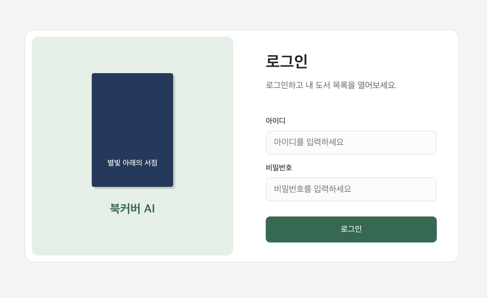
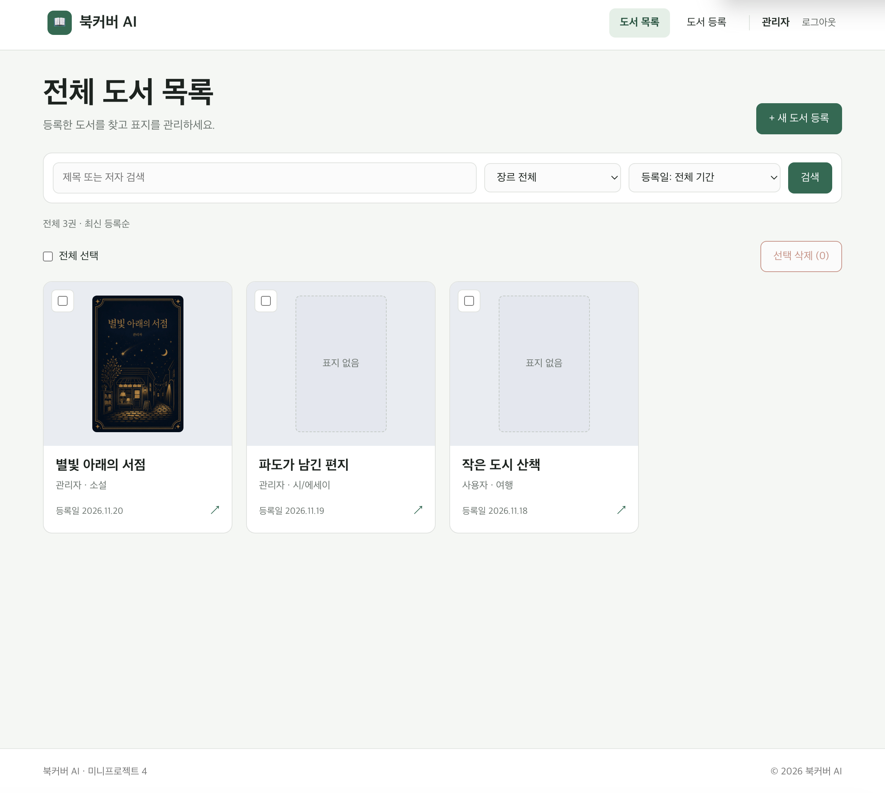
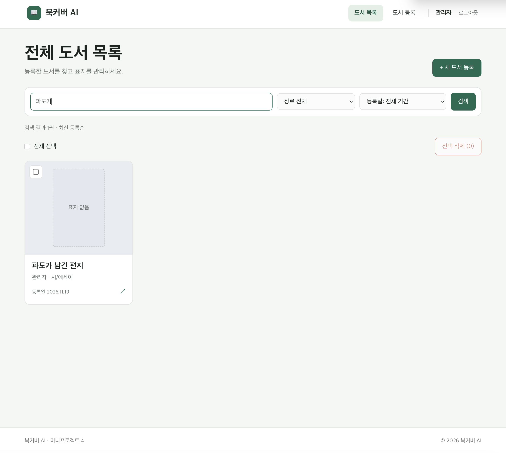
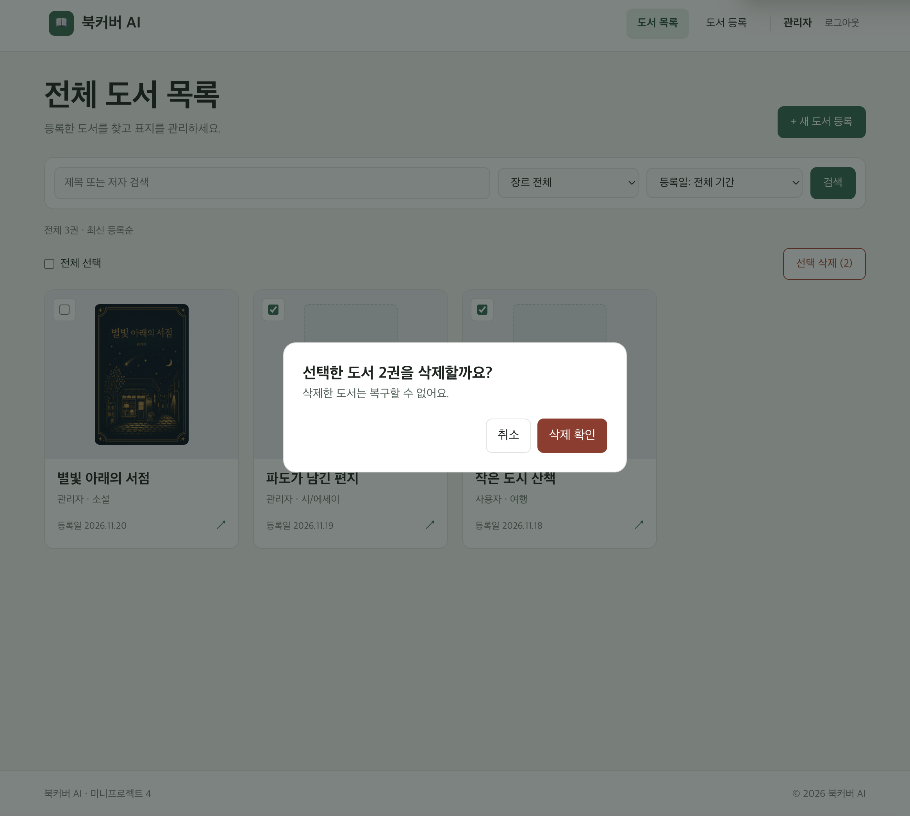
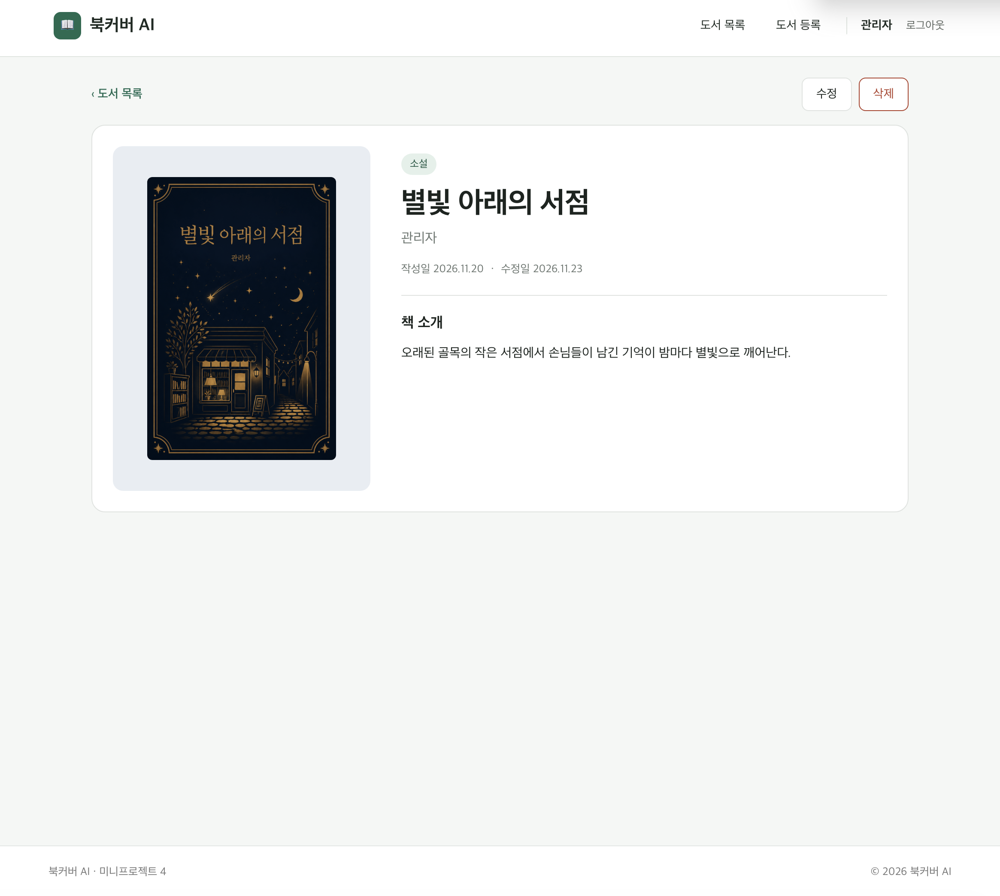
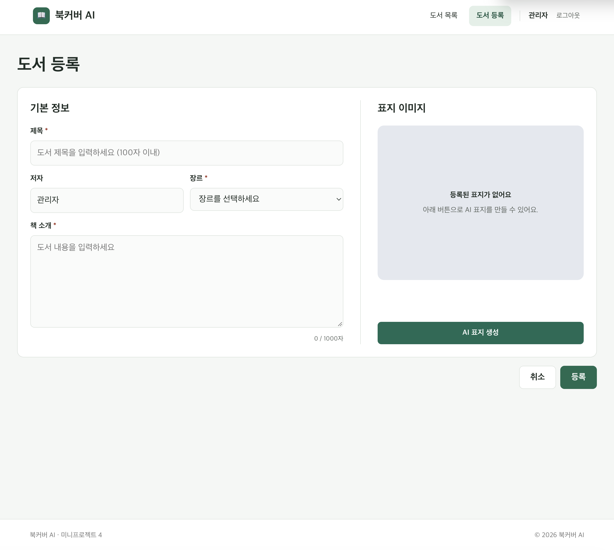
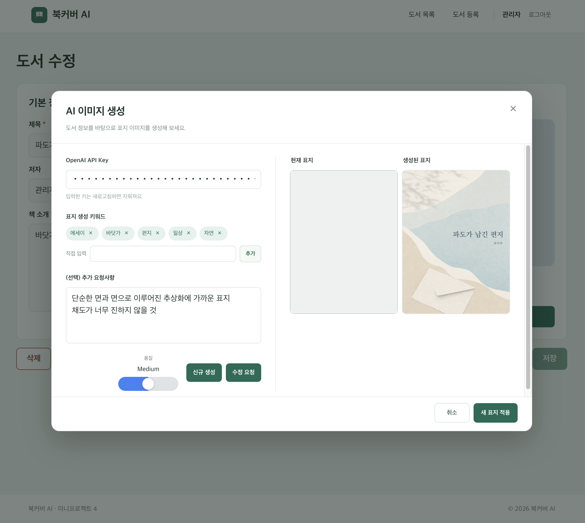
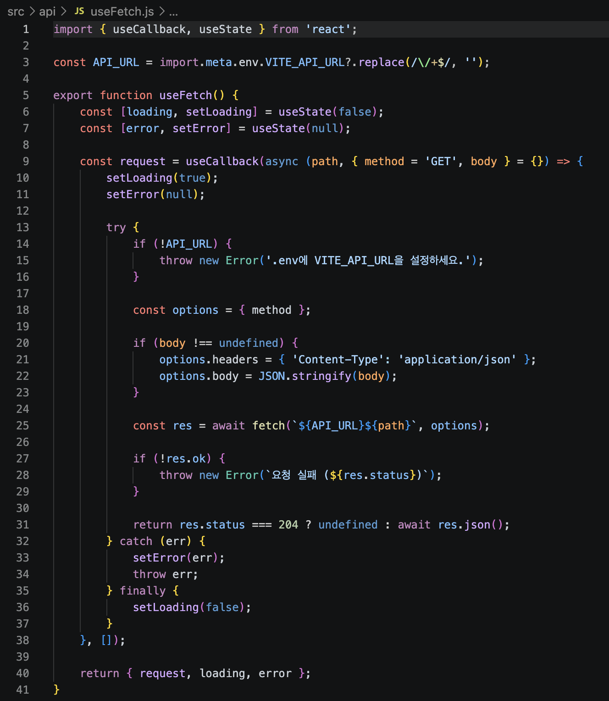
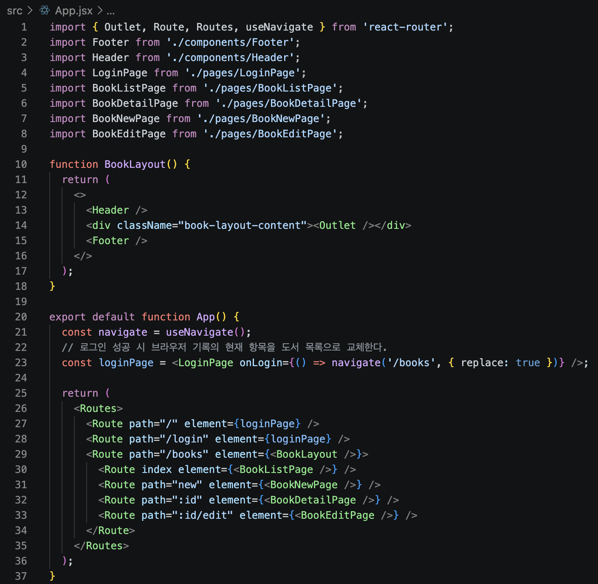

# 창작자를 위한 도서관리시스템

> 창작자가 도서를 등록·관리하고, 도서 내용에 어울리는 표지를 AI로 생성하는 웹 애플리케이션 (Frontend)

## 프로젝트 개요

| 항목 | 내용 |
| --- | --- |
| 서비스명 | 북커버 AI |
| 기간 | 2026.11.20 ~ 11.24 (3일) |
| 과정 | KT AIVLE School 미니프로젝트 4차 (팀 프로젝트) |
| 목표 | React · fetch · CRUD를 실제 프로젝트에 적용하고, 외부 API(OpenAI) 연동 경험하기 |

## 주요 기능

| 구분 | 기능 |
| --- | --- |
| 로그인 | 아이디·비밀번호 로그인, 헤더에 유저 이름 표시와 로그아웃 |
| 도서 목록 | 카드 목록, 검색어·장르·등록일 기간 필터, 최신 등록순 정렬, 로딩·에러·빈 목록 안내 |
| 도서 등록 | 제목·작가·장르·책 소개 입력, 필수값 검증, 작성자는 로그인 정보로 자동 입력 |
| 도서 상세 | 각 BookCard에 대해 표지, 작성일·수정일, 본문 조회 |
| 도서 수정 | 사용자 본인이 등록한 도서 기존 정보를 불러와 수정 |
| 도서 삭제 | 목록에서 여러 권 선택 삭제, 상세에서 단건 삭제, 삭제 전 확인, 권한에 따른 삭제 제어 |
| AI 표지 생성 | 등록·수정 화면에서 도서 정보와 키워드로 OpenAI 표지 이미지 생성 |

## 기술 스택

- **Frontend**: React 19, React Router 7, Vite 8, JavaScript(JSX), 순수 CSS
- **데이터**: json-server 0.17.4 (로컬 REST API, `db.json`)
- **통신**: fetch API (공통 훅 `useFetch`)
- **AI**: OpenAI 이미지 생성 API
- **협업**: Git, GitHub (브랜치 + Pull Request)

## 시작하기

### 사전 준비

- Node.js (개발 환경: v26.13.1), npm

### 설치 및 실행

```bash
git clone https://github.com/gusdnr205/miniproject_4.git
cd miniproject_4
npm ci
```

프로젝트 루트에 `.env` 파일을 만들고 API 서버 주소를 설정합니다. (`.env`는 Git에 올라가지 않습니다.)

```bash
VITE_API_URL=http://localhost:3000
```

터미널 2개에서 각각 실행합니다.

```bash
# 터미널 1 - API 서버 (http://localhost:3000)
npm run dev:api

# 터미널 2 - 웹 화면 (http://localhost:5173)
npm run dev
```

브라우저에서 `http://localhost:5173`에 접속하면 로그인 화면이 열립니다.

> **주의**: API 서버는 반드시 `npm run dev:api`로 실행하세요. `db.json`의 식별자가 대문자 `ID`라서 `--id ID` 옵션이 필요하고, 이 옵션이 `dev:api`에 포함돼 있습니다.

### 테스트 계정

`db.json`의 `user` 항목에 샘플 계정이 있습니다. 비밀번호는 `db.json`을 참고하세요.

| 아이디 | 권한 |
| --- | --- |
| `admin` | 전체 도서 조회·삭제 |
| `user` | 본인이 등록한 도서만 조회·삭제 |

## 화면 및 기능

### 로그인



아이디와 비밀번호로 로그인합니다. 성공하면 유저 정보를 브라우저(`localStorage`)에 저장하고 도서 목록으로 이동합니다. 헤더에는 로그인한 유저 이름과 로그아웃 버튼이 표시됩니다.

### 도서 목록



- 관리자는 전체 도서, 일반 사용자는 본인이 등록한 도서를 최신 등록순으로 봅니다.
- 도서는 카드로 표시하고, 화면 폭에 따라 열 개수가 바뀝니다.
- 검색어, 장르, 등록일 기간(오늘·7일·30일·3개월)으로 필터링합니다.
- 도서가 없거나 검색 결과가 없으면 안내 문구를 보여 주고, 서버 연결에 실패하면 다시 시도할 수 있습니다.



### 도서 삭제



- 목록에서 삭제할 수 있는 도서만 체크박스가 나타나고, 선택한 도서를 한 번에 삭제합니다.
- 삭제 전 확인 팝업을 띄우며, 일부 요청이 실패하면 성공한 도서만 목록에서 제거하고 실패한 도서는 선택 상태로 남깁니다.
- 상세 화면에서도 권한이 있는 도서는 단건 삭제할 수 있습니다.

### 도서 상세



표지, 작성일·수정일, 본문을 확인하고 수정 화면으로 이동할 수 있습니다.

### 도서 등록·수정



제목·장르·책 소개는 필수이며, 공백만 입력하면 안내 문구가 나옵니다. 수정 화면에서는 기존 정보가 미리 채워집니다.

### AI 표지 생성 



등록·수정 화면의 **AI 이미지 생성** 버튼으로 팝업을 열어 표지를 만듭니다.

1. OpenAI API Key를 입력합니다. 키는 화면 상태로만 보관하며 새로고침하면 지워집니다.
2. 표지에 담고 싶은 키워드를 직접 입력하고, 필요하면 추가 요청사항을 적습니다.
3. 도서 제목·작가·책 소개와 키워드로 프롬프트를 만들어 OpenAI 이미지 생성 API를 호출합니다.
4. 현재 표지와 생성된 표지를 나란히 비교하고, 적용한 뒤 도서를 저장하면 `COVER_IMAGE_URL`에 반영됩니다.

API Key는 코드나 `db.json`에 저장하지 않습니다.

## 주요 구현

### 공통 요청 훅 `useFetch`



서버 주소(`VITE_API_URL`), 요청 방식, 에러 처리를 한곳에 모아 모든 화면에서 같은 방식으로 API를 호출합니다.

### 라우팅과 공통 레이아웃



화면마다 주소를 두고, `/books` 아래 모든 화면은 `BookLayout`으로 감싸 헤더와 푸터를 공통으로 사용합니다. 화면별로 파일을 나눠 팀원이 같은 파일을 동시에 수정하는 일을 줄였습니다.

| 주소 | 화면 |
| --- | --- |
| `/`, `/login` | 로그인 |
| `/books` | 도서 목록 |
| `/books/new` | 도서 등록 |
| `/books/:id` | 도서 상세 |
| `/books/:id/edit` | 도서 수정 |

## 프로젝트 구조

```text
src/
├─ api/          useFetch.js            공통 API 요청 훅
├─ assets/       ai-cover.png, book-delete.png, book-detail.png ...       
├─ components/   Header, Footer, BookForm, DeleteBookDialog, ImgGenerator ...
├─ pages/        LoginPage, BookListPage, BookDetailPage, BookNewPage, BookEditPage
├─ styles/       화면·컴포넌트별 CSS
├─ utils/        bookPermissions.js     로그인 유저 확인, 삭제 권한 판단
├─ App.jsx       라우팅
└─ main.jsx      진입점 (BrowserRouter)
```

## 데이터 (db.json)

### 구조

| 테이블 | 필드 |
| --- | --- |
| `books` | `ID`, `TITLE`, `AUTHOR_NM`, `AUTHOR_ID`, `CONTENT`, `COVER_IMAGE_URL`, `GENRE`, `CREATED_AT`, `UPDATED_AT` |
| `user` | `ID`(로그인 아이디), `USER_NM`, `PASSWORD`, `CREATED_AT`, `UPDATED_AT` |
| `genre` | `ID`, `GENRE_NM` |

- 필드명은 대문자 SNAKE_CASE로 통일했습니다.
- `books.AUTHOR_ID`는 `user.ID`, `books.GENRE`는 `genre.ID`와 연결됩니다.
- `COVER_IMAGE_URL`은 처음에 빈 문자열이고, AI 표지를 적용하면 Data URL이 저장됩니다.

### API

| 기능 | Method | 경로 |
| --- | --- | --- |
| 도서 목록 | GET | `/books` |
| 도서 상세 | GET | `/books/:id` |
| 도서 등록 | POST | `/books` |
| 도서 수정 | PATCH | `/books/:id` |
| 도서 삭제 | DELETE | `/books/:id` |
| 장르 목록 | GET | `/genre` |
| 로그인 조회 | GET | `/user?ID={아이디}&PASSWORD={비밀번호}` |

도서 목록은 쿼리로 조건을 조합합니다.

| 쿼리 | 용도 |
| --- | --- |
| `AUTHOR_ID` | 작성자별 조회 (일반 사용자는 본인 ID, 관리자는 생략) |
| 화면 내 검색 | 조회된 도서 목록을 대상으로 제목(TITLE) 및 저자명(AUTHOR_NM) 기준 부분 일치 검색 |
| `GENRE` | 장르 필터 |
| `CREATED_AT_gte` | 등록일 기간 필터 (시작 날짜 이후) |
| `_sort`, `_order` | 조회 결과 정렬 (`CREATED_AT`, `desc`) |

## 협업 방식

### 역할 분담

| 영역 | 내용 |
| --- | --- |
| 프로젝트 구성·통합 | 저장소·라우팅 구성, Pull Request 확인과 병합 |
| 데이터 | `db.json` 설계, json-server API |
| 인증 | 로그인 화면, 유저 정보 저장 |
| 도서 목록 | 목록 조회, 검색·필터, 삭제 |
| 도서 상세·등록·수정 | 상세 조회, 등록·수정 폼 |
| 공통 UI·문서 | 헤더(유저 정보), 푸터, README |
| AI 표지 | OpenAI 이미지 생성 |

### Git 규칙

- `main`에 직접 push하지 않고, 작업 브랜치를 만들어 Pull Request로 합칩니다.
- 커밋 메시지는 `feat:`, `fix:`, `docs:`, `refactor:`, `style:`, `chore:` 말머리로 시작합니다.
- 작업 시작 전 `git pull`로 최신 `main`을 받습니다.

## 트러블슈팅

| 증상 | 원인 | 해결 |
| --- | --- | --- |
| 화면에 "`.env`에 `VITE_API_URL`을 설정하세요" 에러 | `.env` 파일이 없거나, 만든 뒤 개발 서버를 재시작하지 않음 | 루트에 `.env` 작성 후 `npm run dev` 재시작 |
| 콘솔에 `ERR_CONNECTION_REFUSED` | API 서버가 꺼져 있음 | 다른 터미널에서 `npm run dev:api` 실행 |
| 목록은 나오는데 도서 상세가 "정보 없음" | `--id ID` 없이 json-server를 직접 실행해 `/books/1` 조회 실패 | `npm run dev:api`로 실행 |
| 목록 화면에 "로그인이 필요해요" 표시 | 브라우저에 로그인 정보가 없음 | 로그인 화면에서 로그인 |
| 영어로 검색하면 상관없는 책이 나옴 | json-server의 q가 표지 base64 문자열까지 검색함 | 받아온 목록을 제목·저자로만 거르도록 변경 |

## 한계 및 향후 계획

- 현재 백엔드는 json-server이며, 이후 Backend 미니프로젝트에서 Spring Boot로 교체할 예정입니다.
- 로그인 확인은 `localStorage` 값을 화면 코드에서 확인하는 방식입니다. 삭제 권한도 화면과 버튼을 제어하는 용도이며, 서버 차원의 인증·권한 검사는 없습니다. 비밀번호가 `db.json`에 평문으로 저장되므로 연습용으로만 사용합니다.